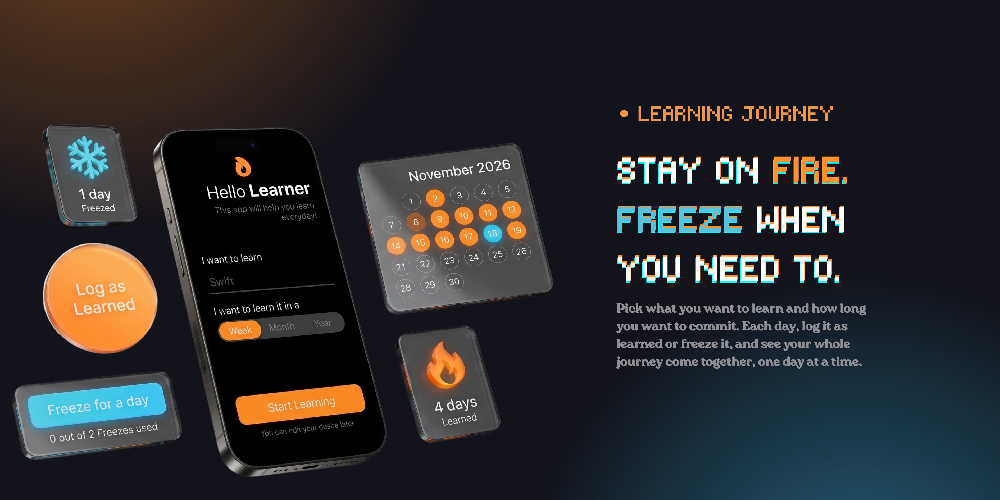

<p align="center">
  
  
  
  
</p>

# 🔥 Learning Journey

> **Stay on fire. Freeze when you need to.**

Pick what you want to learn and how long you want to commit. Each day, log it as learned or freeze it, and see your whole journey come together, one day at a time.

Learning something new isn't about one big day. It's about showing up, again and again. Learning Journey turns that into a streak you'll want to protect.

## How it works

| | |
| --- | --- |
| 🎯 **Set a goal** | Swift, drawing, Arabic… for a week, a month or a year |
| 🔥 **Log your day** | One tap and today counts |
| ❄️ **Freeze a day** | Life gets busy. Your streak stays safe |
| 📅 **Look back** | Every day you showed up, on one calendar |
| ✏️ **Change your mind** | Switch your goal anytime and start a new streak |

## The rules of the fire

- 🧊 **2** freezes a week · **8** a month · **96** a year
- 🕛 One log per day, and a fresh start at **12 AM**
- ⏳ Miss more than **32 hours**, and the flame goes out
- 🔁 Change your goal, and the streak starts over
- 🏁 Reach your goal, and set the next one

## Every ending has a screen

| 👏 Well done! | 💔 You didn't reach your goal |
| --- | --- |
| Your learned and freezed days reached your goal. Ready for the next one? | More than 32 hours passed without a log. Pick a new goal and light it up again. |

## Design

- 🌑 **Dark only**, so the orange and cyan really glow
- 🫧 **Liquid Glass** on every card and button, the new iOS look
- 🟠 **Orange** means learned, 🔵 **cyan** means freezed, everywhere in the app
- 🔥 **App icon** made with Icon Composer, with light, dark and tinted versions

## Under the hood

Built with **MVVM**, keeping every part in its own place:

```
LearningState  →  ViewModels  →  Views
   the brain       the screens     the look
```

- 🧠 **LearningState** is the one shared brain. It keeps the goal, the counters and every day's status, applies all the rules, and is the only one allowed to save.
- 🎛️ **ViewModels** handle each screen's own job, like a goal draft that can be cancelled, or turning `1` into "1 day".
- 🎨 **Views** never decide anything. They ask, and they show.
- 🧩 **Components** like `DayCircle` and `GoalForm` are built once and reused across screens.

## Built with

`SwiftUI` · `@Observable` · `@Environment` · `UserDefaults` · `NavigationStack` · `LazyVGrid` · `glassEffect`

## Run it

```
git clone https://github.com/snmarri/Learning-Journey-App.git
```

Open `Learning Journey App.xcodeproj`, choose an iPhone simulator, and press `Cmd + R`.

---

<p align="center">Made with 🔥 by Safia </p>
